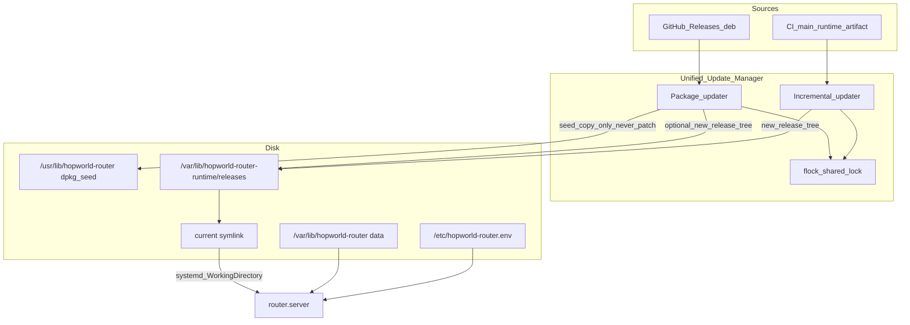

# 独立运行时 + APT/增量双通道更新

## 现状结论（避免重复建设）

- DEB 代码树扁平落在 [`/usr/lib/hopworld-router`](deploy/build-deb.py)，由 dpkg 管理；数据在 [`/var/lib/hopworld-router`](deploy/debian/hopworld-router.service)，配置在可选的 `/etc/hopworld-router.env`。
- 更新目前按安装形态**互斥**：APT 走 [`hopworld-package-update.py`](deploy/debian/hopworld-package-update.py)；Git 走 [`hopworld-router-page-update`](deploy/hopworld-router-page-update)（跟 Release 标签）。CLI [`hopworld-update.sh`](deploy/hopworld-update.sh) 跟 `main` 但不接 UI、无签名。
- **可复用**：legacy 的 `releases/<ver> + current` 原子切换（[`install-legacy.sh`](deploy/install-legacy.sh)）；oneshot + 窄 sudoers + `page-status.json` + [`require_service_ready`](router/system_update.py)；[`UpdateCenter`](router/update_center.py) 事件/偏好；Release 选包与 SHA-256（[`release_channel.py`](router/release_channel.py)）；`v1-checks` 已能在 main 上构建（尚未持久化产物）。
- **不可复用为增量落地**：就地改 `/usr/lib/hopworld-router`；把 UI 直接改成 `git pull main`。

## 目标架构

**硬规则**：增量与运行时切换只写 `/var/lib/hopworld-router-runtime/**`；**禁止**改写 dpkg 拥有的 `/usr/lib/hopworld-router/**` 与 unit 文件本体（可用 drop-in）。

## 磁盘与版本模型

| 记录项 | 存放 |
|--------|------|
| APT 安装版本 | 现有 `HOPWORLD_PACKAGE_VERSION` / `dpkg-query` |
| 实际运行版本目录 | `/var/lib/hopworld-router-runtime/current` → `releases/<id>` |
| Git Commit SHA | `releases/<id>/RUNTIME.json` 内 `commit`；另写 `state.json` 的 `running_commit` |
| 增量更新记录 | SQLite `update_events`（扩展 target=`incremental`）+ `/var/lib/hopworld-router-runtime/history.jsonl` |

目录约定：

- `/var/lib/hopworld-router-runtime/releases/<id>/`：完整可运行树（至少含 `router/`，与现 deb 应用树同构）
- `/var/lib/hopworld-router-runtime/current`：原子 `ln -s` + `mv -Tf`
- `/var/lib/hopworld-router-runtime/state.json`：channel、baseline、last_good、pending
- 备份：切换前把「当前树路径 + state」记入 `backups/<timestamp>/`（数据/env **不**进备份树，继续独立）

`<id>` 格式：`apt-<pkgver>-<seedsha12>`（包种子）或 `git-<fullsha>`（main/Release 运行时）。

## systemd 与无损迁移（已有 APT 用户）

1. 新包（或迁移 oneshot）安装 root 助手与 drop-in：
   - drop-in 仅改 `WorkingDirectory=` / `ExecStart=` 指向 `.../current`（或 `python3 -m router.server` 且 `PYTHONPATH=current`），**不**改 `HOPWORLD_DATA`、User、EnvironmentFile。
2. 首次启动迁移（幂等）：
   - 若无 `current`：把 `/usr/lib/hopworld-router` **复制**为 `releases/apt-<pkgver>-<hash>/`，写 `RUNTIME.json`，原子挂上 `current`。
   - 写 marker：`/var/lib/hopworld-router-runtime/migrated-from-apt`。
3. 之后 `apt upgrade`：
   - 仍更新 dpkg 种子树；
   - postinst **不得**把 `current` 强行指回种子（避免运行版本被意外降级）；
   - 仅当稳定通道且运行 commit 落后于新包声明的 `SOURCE_COMMIT`、或管理员显式「同步到整包」时，才从新种子再派生 release 并切换。
4. 配置、DB、内核、VPN、证书路径不变（继续 `HOPWORLD_DATA` / env）。

`APP_ROOT` 今日用 `__file__.resolve()`（[`system_update.py`](router/system_update.py)）。迁到 `current` 后 managed 判定改为：存在 runtime marker **或** `HOPWORLD_PACKAGE_VERSION` + package helper；勿再要求 `APP_ROOT == /opt/hopworld-router`。

## 产物与 CI

**整包（正式）**：保持 [`stable-release.yml`](.github/workflows/stable-release.yml) → deb + `.sha256`；[`hopworld-package-update.py`](deploy/debian/hopworld-package-update.py) 逻辑保留。

**增量/开发通道（main）**：扩展 [`v1-checks.yml`](.github/workflows/v1-checks.yml)（或新建 `runtime-artifact.yml`）：

1. 现有 unittest + `build-deb` 通过后，再打 **runtime 树归档**（与 deb 内 `/usr/lib/hopworld-router` 同构，不含数据）。
2. 生成 `manifest.json`：
   - `commit`, `parent_commit`, `compatible_package_major`, `created_at`
   - `files[]`：path、op(`add|modify|delete|rename`)、`sha256`、rename 时 `from`
   - 相对「上一成功 artifact 的 commit」或「同主版本最新 Release 的 SOURCE_COMMIT」做 diff（供 UI 预览；落地采用整树替换以保证删/改名正确）。
3. 产物：`hopworld-runtime-<sha>.tar.zst` + `manifest.json` + `manifest.json.sig`。
4. **签名**：Ed25519（minisign 或 cryptography）；**公钥随 APT 包分发**（`/usr/share/hopworld-router/update-keys/…`），私钥仅在 CI secrets。无签名或验签失败 → 拒绝安装。
5. 发布位置：GitHub Actions artifact **或** 仓库 `runtime` 预发布资产；客户端只拉「已签名且 CI 成功」的对象。未签名/仅 raw 文件 **不得** 自动进入生产。

`SOURCE_COMMIT`：构建 deb 时写入包内 `router/build_info.py`（或 `SHARE/.../SOURCE_COMMIT`），供兼容检测与种子 `RUNTIME.json`。

## 统一更新管理器

新建模块（建议）：

- [`router/runtime_layout.py`](router/runtime_layout.py)：路径、state、原子切换、回滚
- [`router/incremental_update.py`](router/incremental_update.py)：检查/下载/验签/兼容/预览
- [`deploy/hopworld-runtime-update`](deploy/hopworld-runtime-update)：root oneshot 执行器（对齐 page-update 的 flock/健康检查风格）
- 共享锁：**一律** `/var/lock/hopworld-router-update.lock`（扩展现有 page-update / 未来 package-update 也 flock 同一锁）

流程（增量）：

1. 读 channel（stable|development）与 prefs
2. 解析目标 commit / artifact URL
3. 兼容：`compatible_package_major == RELEASE_MAJOR`；development 才允许 main tip
4. 验签 + 全树/清单哈希
5. 解压到 `releases/git-<sha>/`（完整树）
6. 备份指针 → 切 `current` → `systemctl restart hopworld-router` → [`require_service_ready`](router/system_update.py)
7. 失败：恢复旧 `current` + 再健康检查；写 `failed` 状态与事件

整包升级：现有 APT 路径包进同一锁；升级后更新「APT 版本」记录，**默认不降级** `current`。

## API / UI（统一后台）

扩展现有「更新与维护」与铃铛，避免第二套页面：

- `GET /api/system/update`（或拆 `GET /api/v1/updates/status`）返回双通道：
  - `package`: 现有 deb 比较结果
  - `incremental`: `state`, `current_commit`, `target_commit`, `changed_files`（来自 manifest）, `channel`
  - `versions`: `{apt, running_id, running_commit}`
- 操作：检查、应用整包、应用增量、预览差异、回滚到 `last_good`、设置（稳定/开发、自动检查/自动应用；**开发通道默认不自动应用**）。
- UI：通道文案区分「正式 Releases / APT」与「开发 main（已签名产物）」；文件列表复用现有 banner `changed_files`。

## 通道策略（对应你的第 12 条）

| 通道 | 整包 | 增量 |
|------|------|------|
| **stable（默认）** | GitHub Releases deb | 仅允许「指向已发布 tag 的 runtime」或关闭增量自动；不自动追 main |
| **development** | 仍可用正式 deb | 允许已签名 CI 产物追 main；需显式开启；自动应用默认关 |

## 实施阶段（可交付、可回滚）

### 阶段 A — 地基（不破坏现网）
- runtime 目录 + state + 原子切换 + 共享锁
- APT 无损迁移 + systemd drop-in
- 版本三元组进入 `/api/status` 与维护页只读展示
- 测试：迁移幂等、不写 dpkg 树、失败回滚 symlink

### 阶段 B — 增量落地
- CI runtime 归档 + manifest + Ed25519 签名
- root 执行器 + API/UI 检查/应用/预览/回滚
- 与 package-update 互斥锁
- 测试：验签失败拒绝、删/改名通过整树切换体现、健康检查失败回滚

### 阶段 C — 策略与文档
- stable/development 偏好与自动更新规则
- 更新 [`docs/V1版本发布与更新.md`](docs/V1版本发布与更新.md)、README 维护节
- deb postinst「不降级 current」行为验收

## 关键文件

- 新增：`router/runtime_layout.py`, `router/incremental_update.py`, `deploy/hopworld-runtime-update`, runtime unit/sudoers, CI workflow 片段, `tests/test_runtime_update.py`
- 修改：[`router/system_update.py`](router/system_update.py), [`router/update_center.py`](router/update_center.py), [`router/server.py`](router/server.py), [`router/static/app.js`](router/static/app.js) / [`index.html`](router/static/index.html), [`deploy/build-deb.py`](deploy/build-deb.py), [`deploy/debian/postinst`](deploy/debian/postinst), [`.github/workflows/v1-checks.yml`](.github/workflows/v1-checks.yml)

## 明确不做（防膨胀）

- 不在增量里自动升级系统依赖 / 代理内核 / strongSwan
- 不用 raw.githubusercontent 无签名文件作为生产来源
- 不把 `/opt/hopworld-router` Git 工作树改成唯一增量方式（Git 安装同样挂到 runtime `current`，与 APT 对齐）
